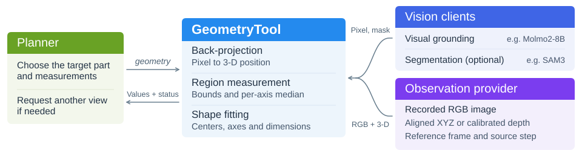

.. _geometry-toolkit:

Geometry Toolkit
================

``GeometryTool`` is a general-purpose tool for geometric perception. Through
``geometry``, the planner describes the object and the part to measure. The
tool computes a position, direction or size from one recorded camera view.

Design Purpose
--------------

A robot may need the position, orientation or size of a particular part
to plan its next action. A 3-D observation gives the position of a
visible surface point directly. Estimating a part's center, axis or
radius usually requires several points along an edge or across a curved
surface. ``GeometryTool`` gives robot applications a common interface for
these measurements. The planner describes the target and the quantities
it needs, and the tool measures them using one recorded camera view. If
that view supports only some of the requested measurements, the tool
returns the available values and explains what is missing for the rest.
The planner can then decide whether to observe the target from another
angle.

.. _geometry-module-design:

Module Design
-------------

The planner calls ``geometry`` with a target description in ``query`` and
a camera name in ``camera``. The tool reads one recorded view and locates
each part the measurement needs. A visual model selects a pixel on the
part in the color image. The tool uses back-projection to find that
pixel's 3-D position in the reference frame.

For a surface point, the tool returns that position directly. For a
region or shape, a segmenter such as SAM3 outlines the part in the image.
The tool uses the valid 3-D points in that region to calculate bounds or
fit a shape. The planner uses the result to decide whether to record
another view and call ``geometry`` again.

         view supplies 3-D data. GeometryTool returns measurements and
         status to the planner.
   :align: center
   :width: 100%

   ``GeometryTool`` module architecture.

.. _geometry-prompt-design:

Point-Selection Prompt
~~~~~~~~~~~~~~~~~~~~~~

The planner's ``query`` should identify one object by its appearance and
spatial relations, and name the part to measure. For fitted quantities,
the tool adds the corresponding part description, such as a sealed top
lid or an inner upper rim, before asking Molmo2-8B to select a point.

The Molmo service's ``geometry`` mode requests one visible material point
on that exact part. A rim needs rim material; a lid needs its top face.
An empty center, interior floor or side wall cannot substitute for that
part. The model selects only a 2-D point; subsequent computation estimates
geometric centers and dimensions. If the object or part is not visible,
or similar instances cannot be distinguished, the model should report
no match. The tool leaves that part unknown without reading 3-D coordinates
or calling the segmenter for that point. If none of the requested results
can be computed, it returns ``need_observation``.

The service scales Molmo2's 0–1000 coordinates by the original image width
and height to produce ``(col, row)`` pixels, clamping the right and bottom
image edges to the last pixel. The tool converts these to array order
``[row, col]`` and verifies the original resolution before reading the
3-D observation. No parseable single point means no coordinates. Flash
keeps its separate default manipulation-point prompt.

.. _processing-flow:

Choosing a Measurement
~~~~~~~~~~~~~~~~~~~~~~

``measurement`` defaults to ``surface_point``, which returns the 3-D
coordinates of one visible point on the target surface in ``world_xyz``.
With ``visible_region``, ``visible_bounds_xyz`` gives the range of valid
3-D points in the visible region along each axis, and ``world_xyz`` gives
the median on each axis. To measure a part's center, orientation or size,
list 1 to 10 quantities in ``required_geometry``. The tool fits shapes to
the 3-D points and returns each result under ``geometry``.

.. list-table:: Measurement Methods for Different Objects
   :header-rows: 1
   :widths: 16 44 40

   * - Object
     - Observation needed
     - Method and result
   * - Any object
     - A visible surface point with valid 3-D coordinates.
     - ``surface_point`` returns the 3-D position of that point directly.
   * - Cube
     - 3-D points along all four edges of the top face and near each corner.
       Supply the camera pose so the tool can check for occlusion at the edges.
     - Request ``rectangle_center`` to fit a rectangle and return the
       center of the top face.
   * - Cup with a circular rim
     - A long enough arc of the rim with valid 3-D points along its edge.
     - The tool fits a circle to the rim points. ``rim_center`` gives the
       center of the opening and ``rim_radius`` gives its radius.

.. _request-and-result-contract:

Measuring a Cup
~~~~~~~~~~~~~~~

Suppose there is one cup with a circular rim on the table. We want to
know how wide the opening is and how tall the cup is. We can calculate
the rim diameter from its radius, so the planner requests ``rim_radius``
and ``height``. In this example the camera is called ``table_camera``.
Omitting ``step`` uses its default of ``-1``, the latest recorded
observation from that camera.

.. code-block:: json

   {
     "query": "the cup on the table",
     "camera": "table_camera",
     "required_geometry": [
       "rim_radius",
       "height"
     ]
   }

.. list-table::
   :header-rows: 1
   :widths: 20 43 37

   * - Quantity
     - What the view must show
     - What the tool returns
   * - ``rim_radius``
     - A long enough arc of the circular rim with valid 3-D points along
       its edge.
     - The radius of the fitted circle in meters. ``radius`` is another
       name for the same quantity.
   * - ``height``
     - Enough of the rim and bottom edges to fit two distinct circles on
       a common axis. If the wall can also be fitted, its axis must agree
       with both ends and the visible wall must lie between them.
     - The distance between the two circle centers in meters.

Suppose a view from above shows only the rim clearly and the fit gives a
radius of about 4 cm. The following excerpt illustrates the result.

.. code-block:: json

   {
     "status": "partial",
     "geometry": {
       "rim_radius": {
         "value": 0.04,
         "unit": "m",
         "evidence_status": "inferred"
       },
       "height": {
         "value": null,
         "evidence_status": "unknown",
         "reason": "both_consistent_end_boundaries_required"
       }
     }
   }

Here ``partial`` means that one of the two quantities has a value. Doubling
the radius gives a rim diameter of about 8 cm. The height is ``null``
because this view lacks a bottom edge to pair with the rim. The status
is ``usable`` when all requested results are available and ``need_observation``
when the view supports none of them.

Surface-point and visible-region results are marked ``measured``. Fitted
values are marked ``inferred``. For each fitted field, ``definition`` and
``unit`` explain the value, and ``world_frame_id`` and ``source_step``
identify the reference frame and recorded step. ``assumptions`` and ``quality``
record the shape assumptions and fit diagnostics. ``source_parts`` lists the
parts used. Follow ``source_refs`` to find the masks, 3-D points and fit
records saved at the original step in the shared ``EnvState``.

.. _observation-contract:

Camera Observations
~~~~~~~~~~~~~~~~~~~

The robot application implements ``get_observation(*, camera, step)`` on its
``ObservationProvider`` to return a ``GeometryObservation``. It defines the
camera names. The resolved ``step`` identifies an existing record in the
shared ``EnvState``. Each ``world_frame_id`` must consistently identify the
same reference frame.

Each observation needs an original-resolution RGB image (``rgb``, an
H × W × 3 ``uint8`` array) and at least one of two sources of aligned 3-D data.

- With a point map, supply ``world_xyz``. This H × W × 3 array gives each
  pixel's position in meters in the reference frame.
- With a depth map, supply optical-axis depth in meters (``depth_m``), the
  3 × 3 pinhole camera matrix (``intrinsics``) and the rigid 4 × 4 transform
  from camera to reference frame (``camera_to_world``). The tool uses these
  to compute the 3-D coordinates. Camera Z points forward. The application
  defines the orientation of the reference frame.

LIBERO, RoboDojo and Franka look up a pixel's 3-D position with
``back_project``. RoboCasa365 uses ``back_project_batch`` and RoboTwin
uses ``sample_world_xyz``. To connect ``GeometryTool``, the application's
``ObservationProvider`` supplies the full RGB image together with the
corresponding data below.

.. list-table:: Sources of 3-D Data by Platform
   :header-rows: 1
   :widths: 23 38 39

   * - Platform
     - Source of 3-D data
     - What to supply to the geometry tool
   * - MuJoCo / :doc:`LIBERO <../simulators/libero>` and
       :doc:`RoboCasa365 <../simulators/robocasa>`
     - Both environments use robosuite and record world-coordinate maps
       by camera and step.
     - Supply the map as ``world_xyz``. Its pixels and resolution must
       match the RGB image.
   * - SAPIEN / :doc:`RoboTwin <../simulators/robotwin>`
     - RoboTwin uses the camera intrinsics and pose to convert depth in
       meters into a world-coordinate map.
     - Use the map from that camera and step for ``world_xyz``. You can
       also pass the matching depth image as ``depth_m``.
   * - Isaac Sim / :doc:`RoboDojo <../simulators/robodojo>`
     - RoboDojo builds a world-coordinate map from the head or wrist
       camera's depth image and calibration.
     - Supply ``world_xyz`` for that camera and step. You can also supply
       the depth image as ``depth_m``.
   * - Real robot / :doc:`Franka <../real_world_robots/franka>`
     - RGB-aligned depth and camera calibration. A wrist camera also needs
       the end-effector pose at the time of capture.
     - Supply ``depth_m``, ``intrinsics`` and the camera-to-base transform
       as ``camera_to_world``.

.. dropdown:: Valid Points and Optional Observation Data

   Observation arrays are copied into a read-only snapshot. Valid points need
   finite coordinates. If optical-axis depth is supplied or can be derived
   from the camera pose, it must also be finite and positive. Supplied depth
   is checked even when a point map is present. An optional boolean ``valid_mask``
   can exclude additional pixels. A point at the reference origin follows the
   same validity rules.

   The camera pose can orient a plane normal. When cleaning rim or wall
   points, the tool attempts to identify and remove a background plane only
   if the observation supplies an explicit ``up_direction`` in the reference
   frame. Use ``source_refs`` to identify the source of the observation.

.. _responsibilities-and-initialization:

Registering the Tool
~~~~~~~~~~~~~~~~~~~~

Prepare the shared ``EnvState``, the observation provider and a ``MolmoClient``
initialized outside the tool. Set ``point_mode="geometry"`` and inject it
as ``grounder``; ``GeometryTool`` does not create a visual model. The Molmo
service must load existing Molmo2-8B weights through ``MOLMO_CHECKPOINT_PATH``
and support the ``point_mode`` argument.

These are sufficient for a surface-point query. Visible-region queries and
shape fitting also need a ``segmenter``, such as a SAM3 client already
connected by the application. ``model`` records only the model name;
``fit_options`` adjusts the fitting criteria.

The following code registers the instance's ``geometry`` method with an
existing ``toolkit`` and binds its cancellation check at dispatch.

.. code-block:: python

   from functools import partial

   from rpent.robots.components.molmo_client import MolmoClient
   from rpent.utils.rpc import make_rpc_client
   from toolkits.geometry.geometry_tool import GeometryTool

   grounder = MolmoClient(
       make_rpc_client(molmo_endpoint), point_mode="geometry"
   )
   geometry_tool = GeometryTool(
       state=state,
       observations=observations,
       grounder=grounder,
       segmenter=segmenter,
       model="Molmo2-8B",
   )
   geometry = geometry_tool.geometry
   toolkit.add_tool(
       geometry.with_handler(
           partial(geometry, check_cancelled=toolkit.raise_if_cancelled)
       )
   )

See :doc:`interfaces` for toolkit registration and dispatch.

Limits and Runtime Verification
-------------------------------

Occlusion, missing depth or a region that mixes several surfaces can
leave a measurement unknown. Before comparing two views, check that
the target, part definition and reference frame match. Measure again
after the object moves. Combining views into a model of the whole object
or its interior requires a separate reconstruction step. Fit residuals
describe how closely the points match the chosen shape. Actual measurement
error requires an independent measurement for comparison.

Errors while reading an observation, calling a model or saving evidence
return ``status="error"``. If a request omits the required ``camera``, the
toolkit returns an argument error with ``error`` and ``errors`` before
calling the tool.

With the test dependencies installed, run the offline checks from the
repository root.

.. code-block:: bash

   python -m pytest tests/unit_tests/toolkits/geometry \
     tests/unit_tests/rpent/robots/components/test_molmo.py -q

These checks use synthetic observations and substitute model services.
They exercise tool dispatch, coordinate conversion, segmentation retries,
cancellation and part fitting.

.. _geometry-libero-evaluation:

LIBERO Geometry Evaluation
--------------------------

The standalone entry point ``python -m toolkits.geometry.evaluation.experiment``
covers 80 cases and 160 target-part measurements using only the initial
``agentview`` frame. It captures observations, calls GeometryTool, transforms
fixed model reference points using the same-frame object poses, and computes
3-D Euclidean position errors. It performs no robot actions or additional
views and leaves the existing LIBERO runtime unchanged.

``collect``, ``build-truth``, ``infer`` and ``evaluate`` handle capture,
reference generation, inference and error evaluation; use ``--help`` for
each stage's arguments. Live experiments require LIBERO Pro, rendering,
existing Molmo2-8B and SAM3 services. ``infer`` connects through
``--molmo-endpoint`` and ``--sam3-endpoint``, initializing the clients outside
the tool before injection. ``infer --replay`` reuses frozen selections and
masks without contacting model services.

This baseline reruns all 80 cases and 160 measurements with the GeometryTool
source published at commit ``699fa46``. It replays frozen ``step 0 / agentview`` RGB-D,
visual selections and SAM3 masks. No previous predicted coordinates are
combined into this run, and no fresh visual-model inference is performed.

The results below belong to that frozen-input baseline, not an evaluation
with fresh Molmo2-8B selections.

Each evaluation request measures one part center. A computed estimate that
fails quality checks returns ``status="warning"``, ``fit_accepted=false`` and
``warnings`` describing unverified physical boundaries, anchor disagreement
or other unmet checks. The quality thresholds are unchanged; an uncomputable
quantity remains ``null``. Warning coordinates are included in the error
comparison, but have not passed quality checks and provide no calibrated
error bounds.

.. list-table:: Frozen-Input Position Errors
   :header-rows: 1

   * - Group
     - Returned / All Requests
     - Mean (mm)
     - Median (mm)
     - Maximum (mm)
   * - All
     - 160/160
     - 21.329
     - 2.453
     - 378.348
   * - Accepted
     - 18/160
     - 2.233
     - 2.342
     - 3.143
   * - Warning
     - 142/160
     - 23.749
     - 2.498
     - 378.348

Errors include only evaluable requests with returned coordinates. Coverage
also counts refusals, failures and unrun requests. Download the
:download:`evaluation report <../../../../toolkits/geometry/evaluation/report.md>`
for per-part summaries and all per-request coordinate comparisons.

Keep captures, predictions and generated reports outside the source checkout.
After capture, reference generation and inference, set ``GEOMETRY_RUN_DIR``
to that experiment directory and evaluate from the repository root:

.. code-block:: bash

   export GEOMETRY_RUN_DIR="$HOME/rpent-runs/geometry-evaluation"
   python -m toolkits.geometry.evaluation.experiment evaluate \
     --predictions "$GEOMETRY_RUN_DIR/predictions/results.jsonl" \
     --truth "$GEOMETRY_RUN_DIR/truth.json" \
     --output "$GEOMETRY_RUN_DIR/report"

The output contains ``report.md``, ``errors.csv`` and ``metrics.json`` with
per-request coordinate comparisons, grouped statistics and provenance.
The output directory must be new or empty.
