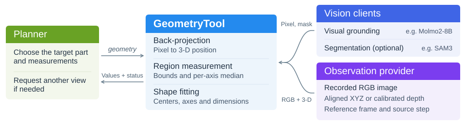

.. _geometry-toolkit:

几何工具包
==========

``GeometryTool`` 是一个通用的几何感知工具。主规划器通过 ``geometry`` 描述要测的物体和部位，工具从指定的一帧相机观测中计算位置、方向或尺寸。

设计目的
--------

规划机器人动作时，主规划器可能需要知道目标部位的位置、朝向或尺寸。表面上一点的位置可以从三维观测中直接读取，而部位的中心、轴线或半径通常需要根据边缘或曲面上的多个点来估计。`GeometryTool` 为不同机器人程序提供统一的测量接口。主规划器描述要测的目标和所需的几何量，工具根据指定的一帧相机观测给出测量结果。如果当前视角只能支持部分测量，工具会返回可用的值，并说明其余量缺少哪些依据，供主规划器决定是否需要换个角度观察。

.. _geometry-module-design:

模块设计
--------

主规划器调用 ``geometry`` 时，用 ``query`` 描述目标，用 ``camera`` 指定相机。工具读取这台相机的一帧已记录观测，依次定位测量所需的部位。视觉模型在彩色图像中选出部位上的一个像素，工具通过反投影找到它在参考坐标系中的三维位置。

测表面点时，工具直接返回这个位置。其他测量还需要分割器（如 SAM3）在图像中圈出相关部位。工具用区域内的有效三维点计算可见范围或拟合形状。主规划器根据结果决定是否需要从另一个视角记录一帧，再调用 ``geometry``。

   ``GeometryTool`` 模块结构。

.. _geometry-prompt-design:

选点提示
~~~~~~~~

主规划器的 ``query`` 应通过外观和空间关系指定唯一的物体，并说明要测的部位。请求拟合量时，工具会补充该量对应的部位描述，例如罐顶面或杯子内口沿，再交给 Molmo2-8B 选点。

Molmo 服务的 ``geometry`` 模式要求选择指定部位上的一个可见材质点：杯口选口沿材料，罐盖选顶面，不能用空心中心、内腔底面或侧壁代替。模型只负责二维选点，几何中心和尺寸由后续计算得到。目标或部位不可见、无法区分相似实例时，模型应回答未找到；工具不继续读取该点的三维坐标或调用分割器，该部位的结果保持未知。所有请求都未能得到结果时，返回 ``need_observation``。

服务将 Molmo2 的 0–1000 坐标按原始图像宽、高转换为像素 ``(col, row)``，并将图像右、下边界限制在最后一个像素。工具再转换为数组使用的 ``[row, col]``，检查原图分辨率后读取三维观测。没有可解析的单个选点时不产生坐标。Flash 使用独立的默认操作选点提示。

.. _processing-flow:

选择测量方式
~~~~~~~~~~~~

``measurement`` 默认为 ``surface_point``，工具通过 ``world_xyz`` 返回目标表面一个可见点的三维坐标。设为 ``visible_region`` 时，``visible_bounds_xyz`` 给出可见区域内有效三维点在各轴上的取值范围，``world_xyz`` 给出各轴的中位数。要测量某个部位的中心、朝向或尺寸，可以用 ``required_geometry`` 指定 1 到 10 个几何量，工具根据三维点拟合形状，并将结果逐项写入 ``geometry``。

.. list-table:: 不同物体的测量方法
   :header-rows: 1
   :widths: 16 44 40

   * - 对象
     - 需要的观测
     - 测量方法与结果
   * - 任意物体
     - 表面上有一个清晰可见、带有效三维坐标的点。
     - ``surface_point`` 直接返回该点的三维位置。
   * - 方块
     - 顶面的四条边和四个角附近都有三维点。还需提供相机位姿，以判断边缘是否被遮挡。
     - 请求 ``rectangle_center``，工具拟合矩形并返回顶面中心。
   * - 圆口杯
     - 能看到足够长的一段杯沿，边缘上有有效的三维点。
     - 用杯沿上的点拟合圆。``rim_center`` 返回杯口中心，``rim_radius`` 返回杯口半径。

.. _request-and-result-contract:

测一只杯子的尺寸
~~~~~~~~~~~~~~~~

假设桌上放着一只圆口杯，我们想知道杯口有多宽、杯子有多高。杯口直径可以由半径算出，因此主规划器请求杯口半径 ``rim_radius`` 和杯高 ``height``。本例中的相机名为 ``table_camera``。省略 ``step`` 时，默认值 ``-1`` 表示读取这台相机最近记录的一帧。

.. code-block:: json

   {
     "query": "the cup on the table",
     "camera": "table_camera",
     "required_geometry": [
       "rim_radius",
       "height"
     ]
   }

.. list-table::
   :header-rows: 1
   :widths: 20 43 37

   * - 请求量
     - 这一帧需要看到什么
     - 能返回什么
   * - ``rim_radius``
     - 一段足够长的圆形杯沿，边缘上有有效的三维点。
     - 拟合圆的半径，单位为米。``radius`` 是同一个量的另一个名称。
   * - ``height``
     - 杯口和杯底的边缘各能拟合出一个圆，两端分开且共轴。若杯壁也能拟合，它须与两端共轴，且可见部分位于两端之间。
     - 两个圆心之间的距离，单位为米。

假设从上方只能看清杯沿，拟合出的半径约为 4 厘米。下面是这个情形下的示例返回片段。

.. code-block:: json

   {
     "status": "partial",
     "geometry": {
       "rim_radius": {
         "value": 0.04,
         "unit": "m",
         "evidence_status": "inferred"
       },
       "height": {
         "value": null,
         "evidence_status": "unknown",
         "reason": "both_consistent_end_boundaries_required"
       }
     }
   }

这里的 ``partial`` 表示两项测量中只有一项有值。半径乘以 2，得到杯口直径约 8 厘米。杯高仍是 ``null``，原因是这一帧缺少可与杯口配对的杯底边缘。所有请求的量都有值时，状态为 ``usable``。当前观测不足以给出任何请求结果时，状态为 ``need_observation``。

直接从表面点或可见区域得到的结果标为 ``measured``，拟合值标为 ``inferred``。读取拟合结果时，``definition`` 和 ``unit`` 说明数值的含义和单位，``world_frame_id`` 和 ``source_step`` 标明参考坐标系和观测步骤。``assumptions`` 和 ``quality`` 记录拟合所用的假设及检查结果。``source_parts`` 列出用到的部位，``source_refs`` 可找到保存在共享 ``EnvState`` 原步骤下的掩码、三维点和拟合记录。

.. _observation-contract:

相机需要提供什么数据
~~~~~~~~~~~~~~~~~~~~

机器人程序通过 ``ObservationProvider`` 的 ``get_observation(*, camera, step)`` 提供一份 ``GeometryObservation``。相机名由接入程序定义，解析后的 ``step`` 对应共享 ``EnvState`` 中已有的一条记录，``world_frame_id`` 应始终指向同一个参考坐标系。

每帧都需要原始分辨率的 RGB 图像（``rgb``，形状为 H × W × 3，类型为 ``uint8``），并至少通过下列一种方式提供与图像对齐的三维数据。

- 有三维坐标图时，提供 ``world_xyz``。它的形状为 H × W × 3，每个像素保存参考坐标系中的三维位置，单位为米。
- 有深度图时，提供沿相机光轴的米制深度 ``depth_m``、3 × 3 针孔相机内参 ``intrinsics`` 和 4 × 4 刚体变换 ``camera_to_world``。工具据此将像素转换为三维坐标。相机的正 Z 轴朝前，参考坐标系的方向由接入程序定义。

查询像素的三维位置时，LIBERO、RoboDojo 和 Franka 使用 ``back_project``，RoboCasa365 使用 ``back_project_batch``，RoboTwin 使用 ``sample_world_xyz``。接入 ``GeometryTool`` 时，机器人程序通过 ``ObservationProvider`` 提供整帧 RGB 图像和表中对应的数据。

.. list-table:: 不同平台的三维数据来源
   :header-rows: 1
   :widths: 23 38 39

   * - 平台
     - 三维数据来源
     - 如何提供给几何工具
   * - MuJoCo / :doc:`LIBERO <../simulators/libero>` 和 :doc:`RoboCasa365 <../simulators/robocasa>`
     - 两个环境都使用 robosuite，按相机和步骤记录世界坐标图。
     - 选择与 RGB 图像对齐、分辨率相同的坐标图作为 ``world_xyz``。
   * - SAPIEN / :doc:`RoboTwin <../simulators/robotwin>`
     - RoboTwin 用相机内参和位姿，将以米为单位的深度图转换为世界坐标图。
     - 将同一相机、同一步骤的坐标图作为 ``world_xyz``，对应的深度图可作为 ``depth_m``。
   * - Isaac Sim / :doc:`RoboDojo <../simulators/robodojo>`
     - RoboDojo 根据头部或腕部相机的深度和标定参数生成世界坐标图。
     - 读取该相机在同一步骤的 ``world_xyz``，也可一并提供深度图 ``depth_m``。
   * - 真机 / :doc:`Franka <../real_world_robots/franka>`
     - 与 RGB 对齐的深度图和相机标定参数。腕部相机还需要拍摄时的机械臂末端位姿。
     - 提供 ``depth_m``、``intrinsics`` 和相机到机械臂基座的变换 ``camera_to_world``。

.. dropdown:: 有效点和可选的观测数据

   观测数组会复制为只读快照。有效点的坐标必须有限。如果提供了深度，或者可以根据相机位姿求出光轴深度，深度还必须有限且为正。同时提供深度图和坐标图时也会检查深度。可选的布尔掩码 ``valid_mask`` 可进一步排除无效像素，参考坐标系原点处的点也按相同规则判断。

   相机位姿有助于确定平面法向的朝向。清理口沿或侧壁的三维点时，提供参考坐标系中的上方向 ``up_direction`` 后，工具才会尝试识别并移除背景平面。可用 ``source_refs`` 记录这帧观测的来源。

.. _responsibilities-and-initialization:

在机器人程序中注册工具
~~~~~~~~~~~~~~~~~~~~~~

先准备共享的 ``EnvState``、观测提供方，以及在工具外初始化的 ``MolmoClient``。将客户端设为 ``point_mode="geometry"`` 后，通过 ``grounder`` 注入 ``GeometryTool``；工具不会自行创建视觉模型。Molmo 服务需加载已有的 Molmo2-8B 权重（由服务的 ``MOLMO_CHECKPOINT_PATH`` 指定），并支持 ``point_mode`` 参数。

只测一个表面点时，这些就够了。测可见区域或拟合几何量时，还需提供分割器 ``segmenter``，例如机器人程序已连接的 SAM3 客户端。``model`` 仅记录模型名称，``fit_options`` 用于调整拟合条件。

下面的代码在已有的 ``toolkit`` 中注册实例的 ``geometry`` 方法，并在分发请求时绑定取消检查。

.. code-block:: python

   from functools import partial

   from rpent.robots.components.molmo_client import MolmoClient
   from rpent.utils.rpc import make_rpc_client
   from toolkits.geometry.geometry_tool import GeometryTool

   grounder = MolmoClient(
       make_rpc_client(molmo_endpoint), point_mode="geometry"
   )
   geometry_tool = GeometryTool(
       state=state,
       observations=observations,
       grounder=grounder,
       segmenter=segmenter,
       model="Molmo2-8B",
   )
   geometry = geometry_tool.geometry
   toolkit.add_tool(
       geometry.with_handler(
           partial(geometry, check_cancelled=toolkit.raise_if_cancelled)
       )
   )

工具集的注册和分发机制见 :doc:`interfaces`。

使用边界与运行验证
------------------

遮挡、深度缺失或分割区域混入其他表面，都可能使测量值保持未知。比较两帧的结果前，先确认目标、部位定义和参考坐标系一致。物体移动后应重新测量。把多个视角合成完整物体或内腔的三维模型需要额外的重建步骤。拟合残差反映观测点与所选形状的吻合程度，真实测量误差需要用独立的测量结果验证。

读取观测、调用模型或保存记录时发生错误，工具返回 ``status="error"``。如果请求缺少必填参数 ``camera``，工具集会在调用前返回含 ``error`` 和 ``errors`` 的参数错误。

安装测试依赖后，在仓库根目录运行离线检查。

.. code-block:: bash

   python -m pytest tests/unit_tests/toolkits/geometry \
     tests/unit_tests/rpent/robots/components/test_molmo.py -q

这些检查使用合成观测和替代模型服务，覆盖工具分发、坐标转换、分割重试、取消和部位拟合。

.. _geometry-libero-evaluation:

LIBERO 几何评估
---------------

独立评估入口 ``python -m toolkits.geometry.evaluation.experiment`` 覆盖 80 组、160 次目标部位测量，仅比较 ``agentview`` 起始帧。程序依次采集观测、调用 GeometryTool、用固定模型参考点和同帧物体姿态计算参考坐标，再统计三维欧氏距离误差；不执行机器人动作或补充视角，也不改变原有 LIBERO 运行流程。

``collect``、``build-truth``、``infer`` 和 ``evaluate`` 分别用于采集、生成参考点、推理和误差评估，阶段参数可通过 ``--help`` 查看。实时实验需要 LIBERO Pro、渲染环境及已有的 Molmo2-8B、SAM3 服务；``infer`` 通过 ``--molmo-endpoint`` 和 ``--sam3-endpoint`` 连接服务，在工具外初始化并注入客户端。``infer --replay`` 可复用冻结的选点和掩码，不连接模型服务。

本次基准使用与提交 ``699fa46`` 相同的 GeometryTool 源码，回放冻结的 ``step 0 / agentview`` RGB-D、视觉选点和 SAM3 掩码，重新执行全部 80 组、160 项测量；未拼接旧预测坐标，也未重新推理视觉模型。

下列结果属于该冻结输入基准，不是 Molmo2-8B 重新选点后的评估结果。

本评估每次请求一个部位中心。算出坐标但未通过质量检查时，结果为 ``status="warning"``，字段 ``fit_accepted=false``，并通过 ``warnings`` 记录物理边界未认证、锚点不一致等原因。原质量阈值保持不变，无法形成有效估计时仍返回 ``null``。带 warning 的坐标参与误差比较，但不代表已通过质量检查或具有经过标定的误差范围。

.. list-table:: 冻结输入位置误差
   :header-rows: 1

   * - 分组
     - 返回数 / 总请求
     - 均值（mm）
     - 中位数（mm）
     - 最大值（mm）
   * - 全部
     - 160/160
     - 21.329
     - 2.453
     - 378.348
   * - 通过检查
     - 18/160
     - 2.233
     - 2.342
     - 3.143
   * - 带 warning
     - 142/160
     - 23.749
     - 2.498
     - 378.348

误差只统计有参考点且返回坐标的项，未返回、失败和未运行项保留在返回率统计中。可下载 :download:`评估报告 <../../../../toolkits/geometry/evaluation/report.md>`，查看各部位汇总和全部逐点坐标对比。

采集数据、预测和生成的报告应保存在源码仓库外。完成采集、参考点生成和推理后，将 ``GEOMETRY_RUN_DIR`` 设为该实验目录，再从仓库根目录运行评估：

.. code-block:: bash

   export GEOMETRY_RUN_DIR="$HOME/rpent-runs/geometry-evaluation"
   python -m toolkits.geometry.evaluation.experiment evaluate \
     --predictions "$GEOMETRY_RUN_DIR/predictions/results.jsonl" \
     --truth "$GEOMETRY_RUN_DIR/truth.json" \
     --output "$GEOMETRY_RUN_DIR/report"

输出 ``report.md``、``errors.csv`` 和 ``metrics.json``，包含逐项坐标对比、分组统计及数据来源。输出目录须不存在或为空。
